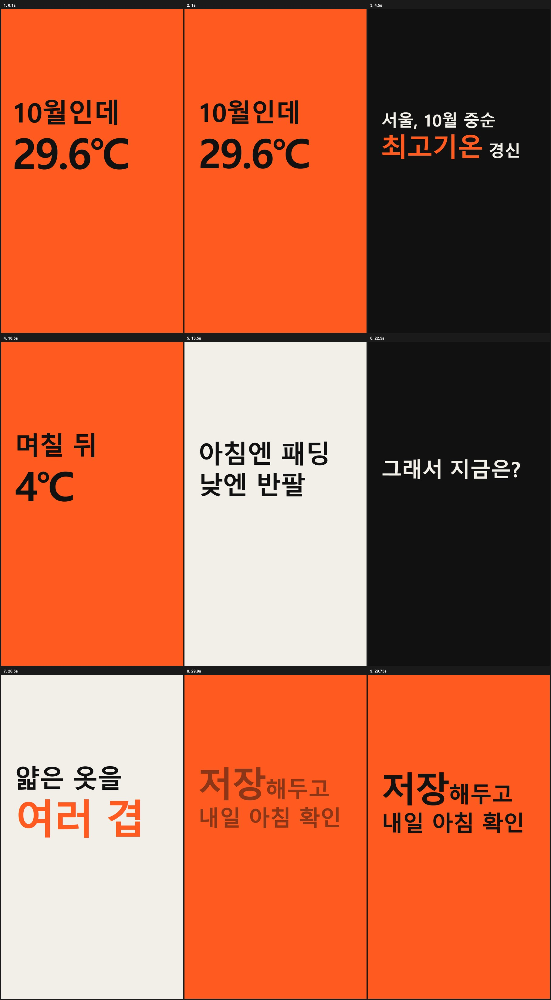

# daily-shorts — 알고리즘의 선택을 기다리며

매일 30초 세로 쇼츠(키네틱 타이포그래피)를 한 편씩 **기획 → 제작 → 검증 → 승인 → 업로드 → 성과 기록**하고,
성과를 다음 날 주제 선정에 다시 넣는 AI 에이전트 스킬입니다. Claude Code 스킬 형식(`SKILL.md`)이며 영상은 [HyperFrames](https://github.com/heygen-com/hyperframes)로 렌더링합니다.



## 하루 흐름

```
 pick ─▶ script ─▶ check ─▶ build ─▶ render ─▶ verify ─▶ approve ─▶ upload ─▶ record
  ▲      (대본)    (게이트)  (HTML)   (MP4)    (게이트)   (사람)      (1일 1편)   │
  └──────────────── 성과 → state/weights.json → 다음 날 주제 점수 ◀────────────┘
```

## 하네스 엔지니어링 6가지 구조

| 구조 | 이 스킬에서의 구현 | 파일 |
|---|---|---|
| **1. 지시·컨텍스트** | 언제 쓰는지, 단계 순서, 완료 조건. 채널 정체성·톤·디자인·금지 사항을 대본 쓰기 전에 매번 읽게 한다 | `SKILL.md`, `references/channel.md`, `references/script-template.md` |
| **2. 도구** | 단계마다 결정론적 스크립트: 주제 점수, 대본 검사, HTML 영상 프로젝트 생성, 업로드, 성과 기록. 영상 렌더는 HyperFrames CLI | `scripts/*.py`, `templates/kinetic.css` |
| **3. 메모리·상태** | 에피소드별 단계 상태(`status.json`)와 실행 로그(`log.jsonl`), 누적 업로드·성과 기록(`history.jsonl`), 카테고리 가중치(`weights.json`) | `state/`, `episodes/<날짜>/` |
| **4. 검증·피드백 루프** | 대본 게이트(길이·훅 3초·줄 12자·숫자엔 출처·14일 중복), 영상 게이트(해상도·길이), HyperFrames `check`·스냅샷. 성과 → 가중치 → 다음 주제 점수 | `scripts/check.py`, `references/checklist.md`, `scripts/analytics.py` |
| **5. 가드레일·권한** | 사람 승인 파일 없으면 업로드 불가, 하루 1편 제한, 기본 dry-run, 비공개+예약 공개, 비밀값은 `.secrets/`(gitignore), 앞 단계 미완료 시 다음 단계 완료 처리 거부 | `scripts/upload.py`, `scripts/run_daily.py`, `.gitignore` |
| **6. 오케스트레이션** | 단계 순서·상태 전이·재시도 2회 제한·멈춤 조건을 관리하고 "다음 할 일"을 안내. 매일 09:00 예약 실행(업로드는 예약에서 제외) | `scripts/run_daily.py`, `references/workflow.md` |

## 설치

```bash
# 1) 스킬 설치 (Claude Code)
git clone https://github.com/<계정>/daily-shorts.git ~/.claude/skills/daily-shorts

# 2) 영상 렌더 도구
npm install -g hyperframes        # Node.js 22.12+ 와 FFmpeg 필요
npx hyperframes skills update     # HyperFrames 스킬

# 3) (선택) YouTube 업로드
pip install google-api-python-client google-auth-oauthlib
# .secrets/client_secret.json 은 Google Cloud 콘솔에서 직접 발급해 넣는다
```

## 사용

Claude Code에서:

> 데일리 쇼츠 오늘 거 진행해줘

직접 실행:

```bash
python scripts/run_daily.py start --slug weather-whiplash   # 오늘 에피소드 생성
python scripts/pick_topic.py                                # candidates.json → topic.json
python scripts/check.py script                              # 대본 게이트
python scripts/build_project.py                             # script.json → HyperFrames 프로젝트
python scripts/run_daily.py status                          # 진행 상황과 다음 할 일
python scripts/upload.py            # dry-run (가드레일 검사만)
python scripts/upload.py --live     # 실제 업로드 (APPROVED 필요)
python scripts/analytics.py record --views 1200 --avg-view-pct 64 --at 24h
```

## 예시

[`examples/2026-10-30-weather-whiplash`](examples/2026-10-30-weather-whiplash) — "10월에 29.6℃, 며칠 뒤 4℃?"
후보 선정(`candidates.json` → `topic.json`), 대본(`script.json`), 생성된 HyperFrames 프로젝트(`video/`), 단계 상태(`status.json`), 실행 로그(`log.jsonl`)가 들어 있습니다.
`status.json`의 build 단계에는 실제로 겪은 실패 2번(GSAP 누락, 장면 선택자 오류)과 수정 기록이 남아 있습니다.

## 폴더 구조

```
daily-shorts/
├─ SKILL.md                 # 에이전트 지시서
├─ references/              # 채널 가이드, 대본 템플릿, 체크리스트, 운영 방법
├─ scripts/                 # run_daily, pick_topic, check, build_project, upload, analytics
├─ templates/kinetic.css    # 키네틱 타이포 스타일
├─ state/                   # history.jsonl, weights.json
├─ examples/                # 예시 에피소드
└─ .env.example             # 비밀값 위치 안내 (값 없음)
```

## 한계
- 서체는 Windows의 맑은 고딕을 `local()`로 불러온다. 다른 OS에서는 `templates/kinetic.css`의 `@font-face`에 한글 서체 파일을 지정해야 한다.
- 음원은 넣지 않았다(무음 시청 기준). 필요하면 HyperFrames `/media-use`로 라이선스 확인된 음원만 추가한다.
- 성과 수집은 수동 입력(`analytics.py record`)이 기본이다. YouTube Analytics API 연동은 확장 과제로 남겨 두었다.
